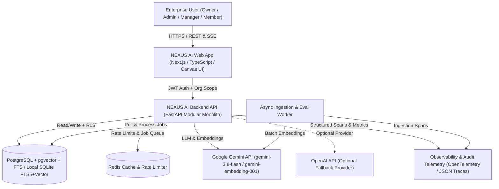
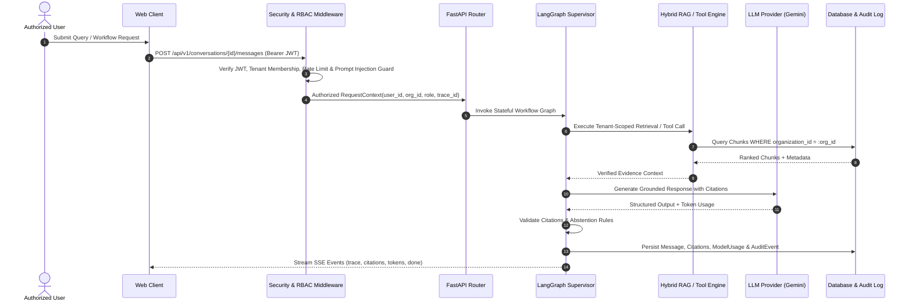
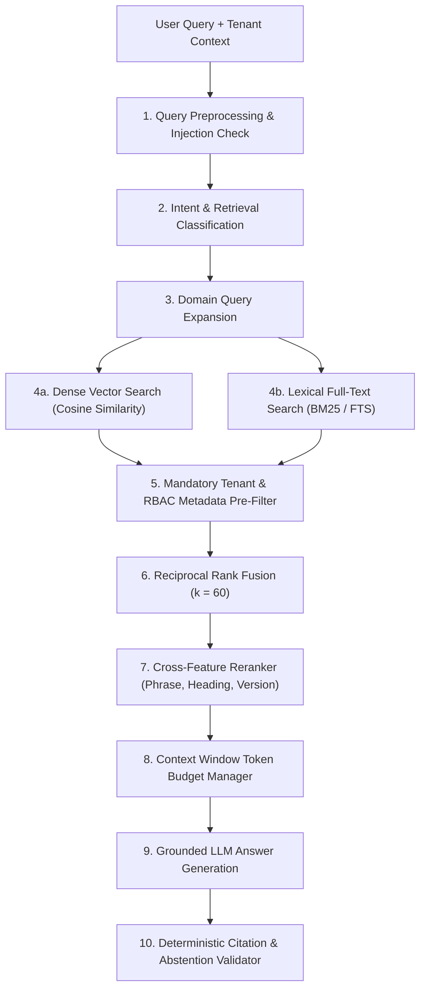
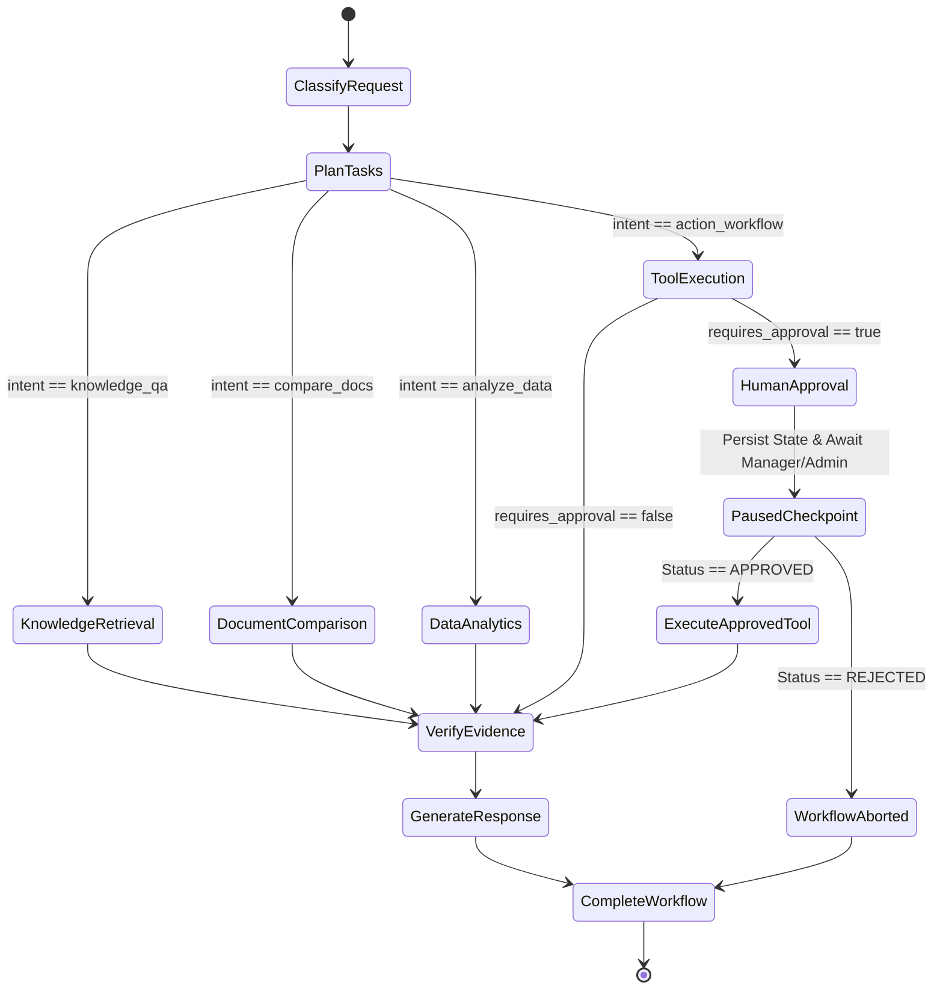
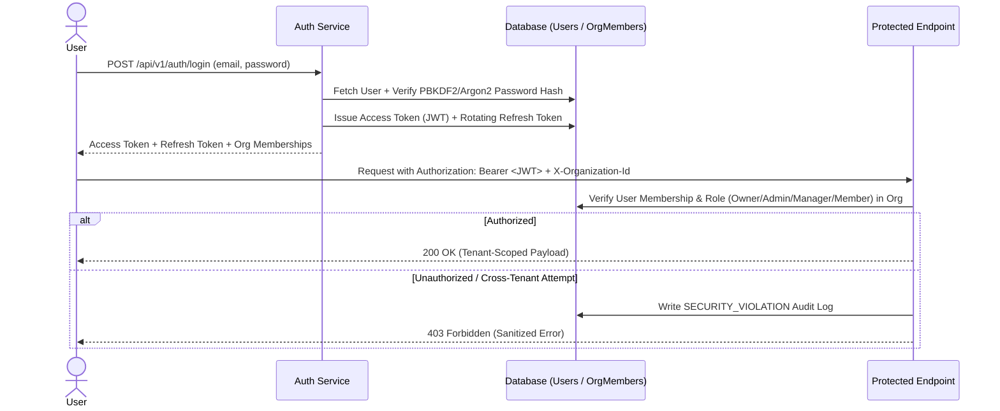
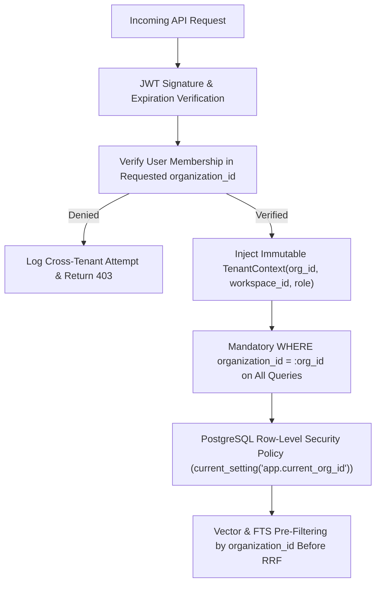
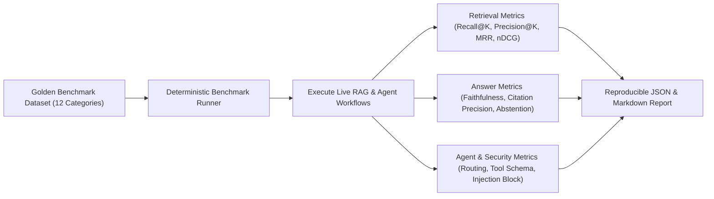
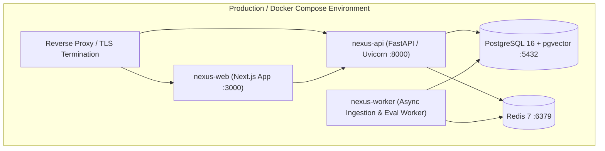

# NEXUS AI — System Architecture & Mermaid Diagrams

## 1. System Context Diagram

## 2. High-Level Modular Monolith Architecture

```mermaid
flowchart LR
    subgraph Frontend["apps/web (Enterprise UI)"]
        UI_Dash["Dashboard & Knowledge Library"]
        UI_Chat["AI Workspace & Citation Viewer"]
        UI_Agent["Agent Workflow & HITL Monitor"]
        UI_Analytics["Analytics & Report Center"]
        UI_Obs["Eval & Observability Dashboards"]
    end

    subgraph Backend["services/api (FastAPI v1)"]
        AuthMod["Module A: Identity, Auth & RBAC"]
        DocMod["Module B: Document Intelligence"]
        RAGMod["Module C: Advanced Hybrid RAG"]
        ChatMod["Module D: Chat & SSE Streaming"]
        AgentMod["Module E: LangGraph Supervisor"]
        ToolMod["Module F: Controlled Tool Registry"]
        DataMod["Module G: Deterministic Analytics"]
        RepMod["Module H: Doc Comparison & Reports"]
        EvalMod["Module I: Evaluation Engine"]
        ObsMod["Module J: LLM Observability"]
        SecMod["Module K: OWASP 2026 Guardrails"]
    end

    subgraph Shared["packages/*"]
        LLMCore["llm_core (Provider Contract)"]
        RetPkg["retrieval (RRF + Reranker)"]
        OrchPkg["orchestration (StateGraph + Checkpointer)"]
        EvalPkg["evaluation (Deterministic Metrics)"]
    end

    Frontend --> Backend
    Backend --> Shared
```

## 3. Request Lifecycle

## 4. Asynchronous Document Ingestion Pipeline

```mermaid
flowchart LR
    Upload["1. Secure File Upload (PDF/DOCX/XLSX/CSV/MD/TXT)"] --> Validate["2. MIME, Size & SHA-256 Deduplication"]
    Validate --> Version["3. Document & Version Record Created (PENDING)"]
    Version --> Queue["4. Ingestion Job Enqueued (Idempotency Key)"]
    Queue --> Parse["5. Structural Parser (Pages, Headings, Tables)"]
    Parse --> Sanitize["6. Indirect Prompt Injection & Malicious Pattern Scan"]
    Sanitize --> Chunk["7. Semantic & Structural Chunker (Overlap + Page Anchors)"]
    Chunk --> Embed["8. Embedding Generation (gemini-embedding-001)"]
    Embed --> Index["9. Transactional Vector + FTS Indexing"]
    Index --> Ready["10. Status = READY + Audit Log"]
```

## 5. Advanced Hybrid RAG Retrieval Pipeline

## 6. Supervisor-Controlled Multi-Agent Orchestration (LangGraph Pattern)

## 7. Authentication, Session & RBAC Authorization Flow

## 8. Multi-Tenant Isolation Architecture

## 9. Evaluation & Benchmarking Pipeline

## 10. Container & Cloud Deployment Topology

